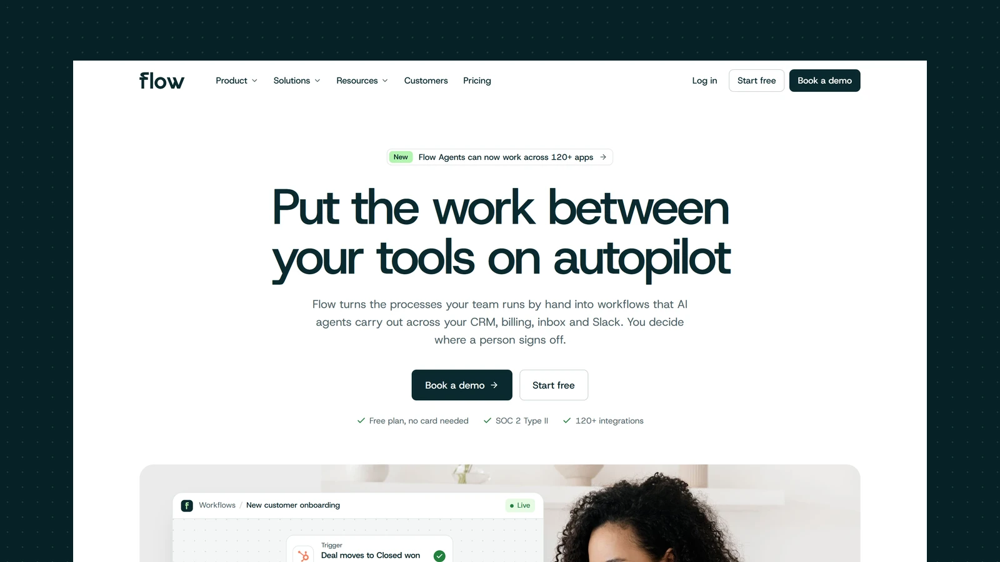

# Flow - Astro SaaS Theme

[](https://flow.xocoweb.workers.dev/)

[](https://astro.build/)
[](https://tailwindcss.com/)
[](https://www.typescriptlang.org/)
[](./LICENSE)

**Live preview:** https://flow.xocoweb.workers.dev/

Flow is a premium Astro theme for SaaS and product companies. Deep spruce and a soft mint on white, a crisp grotesk, and a full-width mega menu give it a confident, grown-up feel, and the product is shown through UI built in HTML and CSS, so it stays sharp at any size. The output is fully static, and the copy lives in config files rather than in the components.

## Features

- A full-width mega menu with icon links, a featured panel per menu, and a row of quick links, plus a full-screen mobile menu
- A hero that layers a live workflow canvas and a Slack approval over a bright photo
- Product UI in HTML and CSS (workflow canvas, composer, run log, agent panel) that stays sharp at every size
- A "How it works" section with three auto-advancing ARIA tabs that pause on hover
- A dark agents section and a tabbed teams section with photos and run cards
- An integrations grid of real connector icons in their brand colours, with 26 connectors included
- Customer stories with a large feature quote, metric cards, and fictional company marks
- A pricing page with a billing toggle, four plans, and a sticky comparison table with a one-plan view on phones
- Four solution pages from one template, each with workflows, a featured workflow, a story, and an FAQ
- A filterable, searchable integrations page
- Customers, about, careers, and contact pages
- A blog with a lead post, topic archives, a table of contents with scroll-spy, a reading-progress bar, co-authored bylines, and a share sheet
- Client-side blog search as a keyboard palette (`/` or `⌘K`) and a results page
- Photo blog covers and portraits from Pexels, credited per image
- Canonical URLs, sitemap, RSS, `robots.txt`, Open Graph, Twitter/X cards, and JSON-LD
- Self-hosted Host Grotesk, Lucide icons, and colour, radius, and type tokens in one stylesheet
- Static output with no framework islands; every animation settles under `prefers-reduced-motion`
- Skip link, landmarks, labelled controls, visible focus states, and keyboard support for every menu, tab set, and dialog

## Tech Stack

- Astro 7 with MDX
- Tailwind CSS 4 via the Vite plugin
- Vite 8, TypeScript, Astro content collections
- `@astrojs/sitemap`, `@astrojs/rss`, Sharp
- Self-hosted Host Grotesk, Lucide and Bootstrap Icons, Simple Icons for integrations, each with its license notice

## Requirements

- Node.js `22.12.0` or newer
- npm

## Getting Started

```bash
npm install
npm run dev
```

Build for production:

```bash
npm run build
```

Preview the production build locally:

```bash
npm run preview
```

Before shipping a change, run type checking, the production build, and the formatter check together:

```bash
npm run release:check
```

## Customization

See [CUSTOMIZATION.md](./CUSTOMIZATION.md) for site settings, the mega menu, homepage sections, the product UI, customers, solution pages, integrations, pricing, the contact, about and careers pages, the blog, sharing, search, feeds, the newsletter form, and the theme's design tokens.

Set `siteConfig.siteUrl` in [src/config/site.ts](./src/config/site.ts) before building — canonical URLs, share images, the sitemap, and the feed are all derived from it. The build is static, so any host that serves a directory works: `wrangler.jsonc` is included for Cloudflare Workers, and Netlify, Vercel, GitHub Pages, and object storage behind a CDN need no configuration beyond `npm run build`.

## Content

Posts live in [src/content/blog](./src/content/blog). Each post is a folder with an `index.md` (or `index.mdx`) and a cover image beside it, validated by the schema in [src/content.config.ts](./src/content.config.ts). Authors and topics are defined in [src/config/blog.ts](./src/config/blog.ts).

The bundled demo content is fictional — the company, the authors, the customers, the quotes, and the figures are invented, so **replace them before launch.** The customer and team portraits are stock placeholders of people with no connection to the names and quotes beside them, and the customer logos are fictional marks.

The product UI shows a fictional app; replace its demo data or swap it for screenshots of your own product.

The integration icons come from [Simple Icons](https://simpleicons.org/) under CC0. The brands are trademarks of their owners, appear as placeholder content only, and imply no endorsement or partnership.

Demo photography comes from [Pexels](https://www.pexels.com/) under its license, credited in [src/config/home.ts](./src/config/home.ts), [src/config/customers.ts](./src/config/customers.ts), [src/config/solutions.ts](./src/config/solutions.ts), [src/config/about.ts](./src/config/about.ts), [src/config/careers.ts](./src/config/careers.ts), and [src/config/blog.ts](./src/config/blog.ts). Blog cover photos are credited under each post.

## Support

See [SUPPORT.md](./SUPPORT.md) for what a license includes, and [CHANGELOG.md](./CHANGELOG.md) for release history.

## License

Commercial license. See [LICENSE](./LICENSE) for complete terms.

## Credits

- [Host Grotesk](https://github.com/Element-Type/HostGrotesk) by Element Type, under the SIL Open Font License
- The fictional company logos are set in Fraunces, Space Grotesk, Syne, Archivo Black, Outfit, DM Serif Display, Sora, Unbounded, Manrope, and IBM Plex Mono, all under the SIL Open Font License, converted to outlines
- [Lucide](https://lucide.dev/), under the ISC License
- [Bootstrap Icons](https://icons.getbootstrap.com/), under the MIT License
- [Simple Icons](https://simpleicons.org/), under CC0
- Photography from Pexels, credited per image
